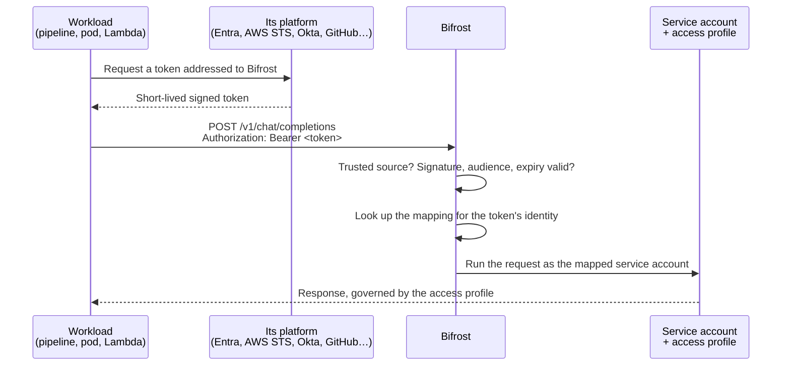

A CI pipeline, an AKS service, an AWS Lambda or an internal batch job usually calls Bifrost with a virtual key. That key is a long-lived secret: someone has to store it in the workload, rotate it, and revoke it when it leaks.

**Workload identity** removes the key. The workload sends a short-lived token that its own platform already issues, such as an Entra managed identity token, an AWS STS token or a GitHub Actions OIDC token. Bifrost checks that the token comes from a source you trust, looks up which **service account** that workload is mapped to, and runs the request as that service account. The service account's access profile decides the models, MCP tools, budget and rate limits, and logs and audit entries name it.

<Info>
  Workload identity is about callers authenticating **to** Bifrost. It is separate from how Bifrost authenticates to model providers, such as IRSA or GKE Workload Identity for Bedrock and Vertex AI.
</Info>

## How it works

Three pieces make this work:

| Piece | What it is | Where you set it |
|---|---|---|
| **Token source** | Who issues the tokens Bifrost accepts: an additional **trusted issuer** (an AWS account, Okta, Auth0, Keycloak, a Kubernetes cluster, GitHub Actions or any OIDC provider), or **Azure workload identity federation** when your SSO is Microsoft Entra. | **User Provisioning**, on the SSO provider |
| **Service account** | A non-human Bifrost user. Its access profile governs what the workload may do. | **Governance → Users** |
| **Workload identity** | A mapping from one workload, named by a claim in its token, to one service account. | The service account's **Workload identities** tab |

Workload identities only ever map to service accounts, never to people.

## How tokens map to service accounts

Each token source names the workload with one claim. That value is what you enter when you map the workload, and it decides which service account the request runs as.

| Token source | Claim that names the workload | Example value | Matched |
|---|---|---|---|
| Azure workload identity federation | `oid`, the service principal's object ID | `6a1f0c3e-2b4d-4f8a-9c7e-5d3b2a1f0e9d` | Ignoring case |
| AWS trusted issuer | `sub`, the IAM role or user ARN | `arn:aws:iam::123456789012:role/payments-batch` | Exactly |
| Generic OIDC trusted issuer | The **workload ID claim** you choose, such as `cid`, `azp` or `sub` | `0oa1b2c3d4e5f6g7h8i9` or `repo:acme/payments:ref:refs/heads/main` | Exactly |

A workload maps to one service account, and several workloads can map to the same one. For example, the AKS pod, the Lambda and the deploy workflow behind one payments service can all run as a `payments-api` service account:

<Frame caption="One service account with three workloads mapped to it, one from each kind of token source.">
  
</Frame>

## Choose a token source

<CardGroup cols={2}>
  <Card title="Trusted issuers" icon="certificate" href="/enterprise/workload-identity/trusted-issuers">
    Trust an AWS account, Okta, Auth0, Keycloak, a Kubernetes cluster, GitHub Actions or any OIDC provider. Works with every SSO provider.
  </Card>
  <Card title="Azure Workload Identity Federation" icon="microsoft" href="/enterprise/workload-identity/azure">
    Map Entra managed identities and app registrations. Needs Microsoft Entra as your SSO provider.
  </Card>
</CardGroup>

You can use both at once: with Entra SSO, Azure workloads come through Azure workload identity federation and everything else through trusted issuers.

## Set it up

<Steps>
  <Step title="Create a service account">
    Under **Governance → Users**, add a service account for the workload and attach an access profile that grants the models and tools it needs. A service account with no access profile is refused by governance, as for any user without one.
  </Step>
  <Step title="Trust the token source">
    Add a [trusted issuer](/enterprise/workload-identity/trusted-issuers), or set up [Azure workload identity federation](/enterprise/workload-identity/azure) on your Entra SSO app.
  </Step>
  <Step title="Map the workload to the service account">
    On the service account, add a workload identity for the token source and the workload's identity value. See [Map a workload](#map-a-workload-to-a-service-account) below.
  </Step>
  <Step title="Call Bifrost with the token">
    The workload requests a token addressed to Bifrost from its platform and sends it as `Authorization: Bearer <token>`, with no virtual key. Each source's guide has client examples.
  </Step>
</Steps>

Workload identity turns on once at least one mapping exists. Until then, every request goes through the rest of authentication unchanged, and virtual keys keep working throughout, so you can move workloads over one at a time.

## Map a workload to a service account

<Steps>
  <Step title="Open the service account's Workload identities tab">
    Under **Governance → Users**, select the service account. Open **Workload identities**; when the sheet is narrow, it sits in the overflow menu at the end of the tab bar.

    <Frame caption="The Workload identities tab appears only on service accounts.">
      
    </Frame>
  </Step>
  <Step title="Choose where the token comes from">
    Select **Add workload identity**. **Token from** lists Azure workload identity federation when your SSO is Entra, and every trusted issuer that is turned on, by name.

    <Frame caption="Token from lists every source Bifrost can accept tokens from.">
      
    </Frame>

    If no source is set up yet, the form says so instead of showing the list.
  </Step>
  <Step title="Identify the workload">
    Enter the value the token carries:

    | Token from | Field | Enter |
    |---|---|---|
    | Azure workload identity federation | **Workload** | Pick the managed identity or app from Entra, or select **Enter an object ID instead** and paste its service principal's object ID. |
    | An AWS issuer | **IAM role or user ARN** | The ARN exactly as IAM shows it, such as `arn:aws:iam::123456789012:role/payments-batch`. |
    | A Generic OIDC issuer | **Workload identifier** | The value of the issuer's workload ID claim, such as a client ID or a `sub`. |

    **Name** is optional and defaults to the workload's name. Select **Add**.
  </Step>
</Steps>

The workload can call Bifrost straight away, and its requests appear in the logs under the service account.

- **Turn a mapping off** with its **Enabled** switch to stop accepting the workload's tokens without losing the mapping.
- **Disconnect** a workload from its row menu to remove the mapping. Deleting a service account removes all of its mappings.
- **Automate** mappings through the API at `/api/governance/users/{user_id}/workload-identities`. Mappings can't be set in `config.json` or Helm; trusted issuers can.

## What Bifrost checks on every request

1. The token comes from a source Bifrost trusts: its `iss` matches a trusted issuer's URL exactly, or your Entra tenant.
2. It is addressed to Bifrost: its audience is one the source is configured with.
3. It belongs to a workload. Entra takes only app-only tokens. A generic issuer takes only tokens whose workload ID is mapped, or that pass its rule when it has one. Anything else, including a person's token, is left to the normal sign-in path, even when the same identity provider runs your SSO.
4. The signature verifies against the source's published keys, and the token is unexpired and valid for no longer than the source's lifetime cap (24 hours by default).
5. A mapping exists for the token's identity, it is turned on, and its source hasn't changed since it was made.
6. The request runs as the mapped service account. The token is removed from the request, so it is never forwarded to a provider.

<Info>
  Tokens are verified on every request and are never stored. A workload's access ends when its token expires and it can't get a new one, or as soon as you turn off or disconnect its mapping.
</Info>

## Responses

| Status | When |
|---|---|
| `400` | A virtual key was sent together with a workload token. Send one credential. |
| `401` | The token is invalid: bad signature, expired, issued for another audience, or valid for longer than the source's lifetime cap. Get a new token. |
| `403` | The token is valid, but no service account is mapped to it, the mapping or issuer is turned off, the issuer changed since the mapping was made, or the service account was deleted. An admin needs to act. |
| `503` | Bifrost couldn't fetch the source's signing keys. Retry after the `Retry-After` delay. |

## MCP gateway

Workload tokens work on `/mcp` too, governed by the service account's access profile like any other request. When the MCP gateway's auth mode is **OAuth only**, it accepts only tokens Bifrost issued, so workload tokens are refused there.

## Permissions

| Action | Permission |
|---|---|
| View a service account's workload identities | **Users → View** |
| Add, change or disconnect a mapping, and search Entra for workloads | **User Provisioning → `UpdateWorkloadIdentities`** |
| Add, change or test trusted issuers | **User Provisioning → Update** |

A mapping lets whoever holds the workload's token act as the service account, so it has its own permission. Admins have it by default; grant it to other roles explicitly. **Users → Update** alone is not enough.
